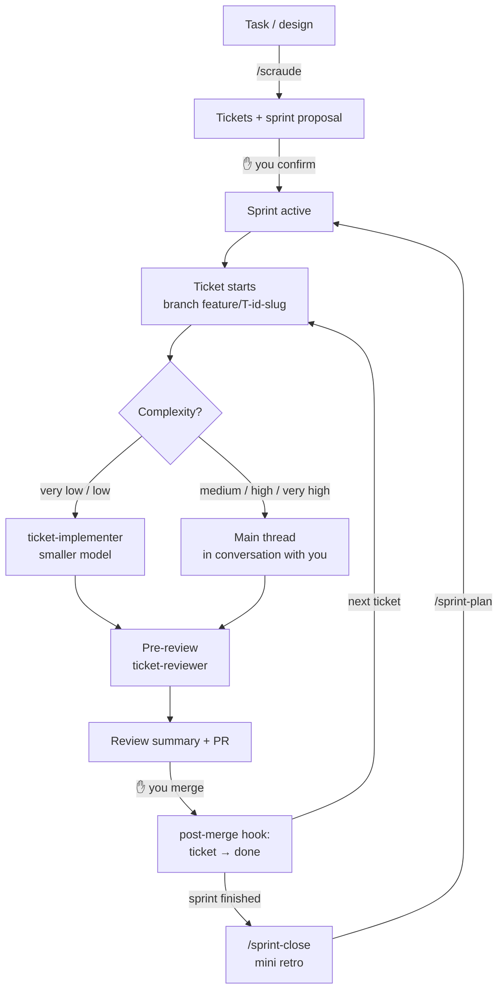

<div align="center">

[Deutsch](README.md) · **English**


# Scraude

**Scrum for working with Claude Code.**
Tasks in, tickets out, one PR per ticket — and no side topic gets lost again.

[](https://code.claude.com/docs/en/plugins)
[](.claude-plugin/plugin.json)
[](LICENSE)


[Install](#install) · [Quick start](#quick-start) · [How it works](#how-it-works) · [Commands](#commands) · [Configuration](#configuration) · [FAQ](#faq)

</div>

> **The plugin itself speaks German.** Commands, board output and field names
> are German (`groesse`, `komplexitaet`, `blockiert_von`), and Claude will
> answer you in German while the plugin is active. This page is a translation
> of the German README, not a separate English edition of the plugin. If you
> want an English build, open an issue.

---

## The problem

Claude Code writes reliable code. What's missing is everything around it:
the overview, the cut of the work, the discipline across several sessions.

| | Without a board | With Scraude |
|---|---|---|
| **A side topic comes up** | ends up in the same giant PR, or is forgotten after the session | gets written down as a backlog ticket without interrupting you |
| **New session** | "Where was I? What's still open?" | the board state is in the context from the first message |
| **Renaming across 40 files** | same large model as for a race condition | mechanical tickets run on a smaller model |
| **Review** | the raw diff, as thorough as the time you happen to have | a second agent checks it against the ticket description first |
| **Scope** | grows until the PR can't be reviewed | tickets are cut for reviewable diffs, and scope creep gets reported |

None of this is a Claude problem. It's the work a board does in a team — and
exactly what's missing when you work alone with an agent.

## The solution

Scraude brings a lean Scrum flow into Claude Code itself: no external tool,
no account, no server.

| | |
|---|---|
| 🧩 **One entry point** | `/scraude "<task>"` breaks the task into tickets with dependencies and proposes the first sprint. You confirm once. |
| 🔒 **Sprint lock** | While a sprint is running, nothing new gets in. Everything new goes to the backlog, however urgent it feels. |
| 🪝 **Catching side topics** | Unrelated to the current ticket? Noted silently as a backlog ticket. Related to it? Claude tells you right away. |
| 🌿 **One branch, one PR per ticket** | `feature/T-<id>-<slug>`, PR via `gh` or `glab`. Tickets are cut so the diff stays reviewable. |
| 🧠 **The right model** | Every ticket carries a complexity rating. Simple tickets go to a subagent on a smaller model; hard ones stay in the conversation with you. |
| 🔍 **Pre-review by a second agent** | Before you see the diff, a separate agent checks it against the ticket description. It fixes the mechanically obvious in its own commit and reports the rest. |
| ☀️ **Standup at session start** | A hook puts the board state into the context automatically. Claude knows where to pick up. |
| 🧵 **Several repos, fresh chats** | A coordinator chat hands the sprint to one chat per repo — restarted each sprint, briefed from the board instead of a long history. |
| 🎨 **Design before code** | When a ticket changes something visible, the draft is made on the design board and agreed with you first. The fixed foundation — colours, text styles, components — ships with every briefing. |
| ✅ **You stay in control** | Claude never merges. PRs, merges and closing a sprint always need your approval. |

---

## Install

Scraude is installed as its own plugin marketplace, straight from this repo.
In a Claude Code session:

```
/plugin marketplace add DerJojo11/scraude
/plugin install scraude@scraude-marketplace
```

Or from the terminal:

```bash
claude plugin marketplace add DerJojo11/scraude
```

```bash
claude plugin install scraude@scraude-marketplace
```

### Requirements

- [Claude Code](https://code.claude.com)
- **Node.js** — the bundled scripts run on `node`, with no npm dependencies
- **Git** — Scraude works with branches and a `post-merge` hook
- *optional:* [`gh`](https://cli.github.com) or
  [`glab`](https://gitlab.com/gitlab-org/cli), logged in, for real
  pull/merge requests. Without either, Scraude falls back to a local merge
  once you approve it in chat.

---

## Quick start

**1. Create the board in your project**

```
/scraude:board-init
```

Creates `.claude/board.json`, adds it to `.gitignore` and installs the
`post-merge` hook.

**2. Hand over a task**

```
/scraude "Notes feature: data model, REST API and an editor in the frontend, offline-capable"
```

A path or a link to a design works as well as free text. Claude breaks the
task down, sets dependencies and priorities, and puts the ticket cut **and**
the sprint proposal in front of you as one list.

**3. Confirm — the rest runs**

After your confirmation the first ticket starts on its own branch. From here
on Scraude is a **mode**: you work with Claude as usual and the flow applies
by itself, including in your next session.

**4. Look at the board**

```
/scraude:board
```

```markdown
## BACKLOG (1)

| ID    | Titel                       | Typ     | Prio | Größe | A/K          | Alter  |
|-------|-----------------------------|---------|------|-------|--------------|--------|
| T-005 | Dark Mode für Einstellungen | feature | 4    | S     | sehr_niedrig | 0 Tage |

## SPRINT S-01 (active) — 0/4 fertig

| ID    | Titel                         | Status      | PR |
|-------|-------------------------------|-------------|----|
| T-001 | Datenmodell für Notizen       | sprint      | —  |
| T-002 | Spike: Sync-Strategie offline | in_progress | —  |
| T-003 | REST-Endpunkte für Notizen    | sprint      | —  |
| T-004 | Notiz-Editor im Frontend      | sprint      | —  |
```

---

## How it works



### What runs on its own and what doesn't

Whether something runs without asking doesn't depend on how important it is,
but on whether it can be **undone** and whether it is **visible to the
outside world**.

| Runs without asking | Needs your approval |
|---|---|
| Starting a ticket, creating the branch | The ticket cut during intake |
| Capturing side topics as tickets | Creating a PR / MR |
| Status changes on the board | Merging (Claude never does it) |
| Pre-review including its fix commit | Closing a sprint |
| Checking Definition of Ready / Done | Splitting scope off into a follow-up ticket |
| Moving on to the next ticket after a merge | Breaking the sprint lock |

### Model choice by complexity

Every ticket carries two separate estimates: `groesse` (how much diff, and
so how much review effort) and `komplexitaet` (how hard the thinking is).
Renaming a field across 40 files is *large but trivial*. Fixing a race
condition is *small but delicate*.

| `komplexitaet` | Model (default) | Effort | Who implements |
|---|---|---|---|
| `sehr_niedrig` (very low) | haiku | low | subagent `ticket-implementer` |
| `niedrig` (low) | sonnet | low | subagent `ticket-implementer` |
| `mittel` (medium) | sonnet | medium | main thread |
| `hoch` (high) | opus | high | main thread, with a hint to switch `/model` |
| `sehr_hoch` (very high) | opus | xhigh | main thread, with a hint to switch `/model` |

If a ticket turns out harder than estimated, **the implementer stops and
says so** instead of muddling through. The rating gets corrected in the
ticket and the work continues in the main thread.

The mapping lives in the board under `modelle` and can be adjusted per
project without touching the plugin.

### A pre-review that grants nothing

The `ticket-reviewer` has not seen how the code came about, and that is the
point. It checks what a generic code review cannot:

- Does the diff cover the ticket description?
- Did scope creep in?
- Does the size match the estimate?

It deliberately **gives no verdict**: no "looks good", no approval. Its
report is there to aim your review, not to replace it.

### Several repos: fresh chats instead of long histories

When a project spans several repos (app, backend, web), a **coordinator
chat** holds the board and hands the work to **one chat per repo**. Those
chats don't carry on across sprints — they are started fresh each sprint,
because a long history is re-read in every new round and eventually costs
more than the work itself.

So that a fresh chat needs no old history, Scraude builds its briefing from
the board: repo, base branch, the tickets with their descriptions, agreed
interfaces, your project rules, the reporting format — and the command the
chat uses to read the board state itself.

- The model follows the complexity of the hardest ticket in the bundle.
- At most `config.maxParallelChats` chats run at once (default 2); blocked
  tickets wait even when a slot is free.
- If a chat dies, its successor picks up on the same branch — reading the
  state from `git status`, not from the lost history. Uncommitted work is
  never discarded.
- Merged tickets lead to their chat being archived, after your confirmation.
  With `config.chatAbschlussSofort` this happens without asking, as soon as
  all of a chat's tickets are done.
  Set `config.chatAbschluss` to `loeschen` and it gets deleted instead —
  permanently, which is why it isn't the default.

Walked through on a two-repo example (in German):
[`examples/zwei-repos.md`](examples/zwei-repos.md).

### Design before code

Optional, and off by default. Design only enters Scraude once
`config.design.tool` is set.

The heart of it is `config.design.fundament`: the lines every ticket sticks
to — which token set colours come from, which text styles exist, which
components get used. They live in the board and ship with every briefing,
including a repo chat with no access to the design tool. This isn't
tidiness: a second orange and a second button radius take five minutes to
create and are in every screen afterwards.

A ticket that changes something visible gets `design: true`. That keeps it
unstartable until the draft exists:

```bash
node scripts/board-store.js check-ready T-001
# { "ready": false, "fehlt": ["Design noch nicht abgestimmt — design.board nicht gesetzt"] }
```

That's not a defect in the ticket, it's the order of things: a draft on the
design board built from the existing components, shown to you as an image,
your notes written back as comments on the board — and only then code.

```bash
node scripts/board-store.js update-ticket T-001 \
  '{"design":{"board":"03 Screens / Login","stand":"abgestimmt"}}'
```

The review checks the result against the agreed draft and the foundation; if
`config.design.export_pfad` is set, an image of it goes into the PR. A
reviewer who has to open the design tool first won't review the design.

---

## Commands

The entry point is `/scraude`. Every other command works qualified
(`/scraude:board`) or short (`/board`). The short form works as long as no
other plugin claims the same name.

| Command | Purpose |
|---|---|
| `/scraude "<task>"` | break the task down, set dependencies, propose the first sprint |
| `/scraude:board-init` | create the board, extend `.gitignore`, install the `post-merge` hook |
| `/scraude:board` | show the board as a Markdown table |
| `/scraude:standup` | status: what's running, paused, blocked, and what comes next |
| `/scraude:ticket-new "<title>"` | add a single ticket to the backlog |
| `/scraude:sprint-plan` | tidy the backlog and plan the next sprint |
| `/scraude:ticket-start [T-<id>]` | start a ticket; without an ID, the most important unblocked one |
| `/scraude:ticket-resume` | resume the most recently paused ticket |
| `/scraude:ticket-review [T-<id>]` | pre-review, Definition of Done, summary, PR |
| `/scraude:sprint-close` | close the sprint, mini retro |

You don't need to know these commands. Once a board exists, Claude starts,
pauses and captures tickets by itself. The commands are entry points and
views.

### Underneath: `board-store.js`

Every state change on the board has a named command in a deterministic Node
script — no tokens are spent on it. Claude calls them itself; you only need
them to look something up or straighten something out by hand.

```bash
node "${CLAUDE_PLUGIN_ROOT}/scripts/board-store.js" <command>
```

| Command | Purpose |
|---|---|
| `get-board` | the board as JSON |
| `create-ticket '<json>'` · `create-tickets '<json-array>'` | create tickets; creating several at once resolves dependencies between them |
| `update-ticket T-001 '<json>'` | change fields |
| `check-ready T-001` | Definition of Ready, the mechanical part |
| `impact` | how many tickets hang off each one — the number behind a spike's priority |
| `model-for [T-001]` | model and effort for this ticket |
| `next-ticket` · `start-ticket` · `resume-ticket` | next unblocked ticket, start it, resume it |
| `review-ticket T-001 [<pr-url>]` · `finish-ticket T-001` | into review, and to `done` after the merge |
| `plan-sprint '["T-001"]'` · `close-sprint [--force]` · `retro [S-01]` | fix a sprint, close it, look at the numbers |

Projects with several repos get four more:

| Command | Purpose |
|---|---|
| `config ['<json>']` | show settings; with an argument, change them |
| `briefing <repo\|T-001 …> [--uebergabe]` | a finished briefing plus model recommendation for a fresh repo chat |
| `chats` | who works on what, how many slots are free, what's waiting |
| `chat <id> <repo> '["T-001"]'` · `chat <id> limit\|fehler\|archiviert\|geloescht` | register a chat, mark it failed or finished |

Called without an argument, the script lists every command.

---

## Configuration

Everything adjustable lives in the board itself, not in the plugin — edit a
line instead of waiting for a release.

| Key | Default | What for |
|---|---|---|
| `modelle` | see the table above | complexity → model and effort for subagents |
| `config.repos` | `{}` | repo name → `pfad`, `base_branch`, `merge_stil`, `schnittstellen` |
| `config.maxParallelChats` | `2` | how many repo chats may run at once |
| `config.chatMessageLimit` | `400` | when a chat finishes its ticket and starts no further one |
| `config.chatAbschluss` | `archivieren` | what happens to a finished chat; `loeschen` is permanent |
| `config.chatAbschlussSofort` | `false` | archive finished chats right away, without asking (never deletes) |
| `config.chat_modelle` | Sonnet up to `mittel`, `inherit` above | model choice for a whole repo chat |
| `config.chat_sonnet_groessen` | `["XS","S"]` | up to which size `mittel` still runs on Sonnet |
| `config.koordinator_chat` | — | session ID the repo chats report to |
| `config.projektregeln` | `[]` | lines from CLAUDE.md that belong in every briefing |
| `config.design` | `{tool: null, …}` | design tool, file, page, `fundament` (the rules that are not up for debate) and `export_pfad`. Without `tool`, design never comes up |

```bash
node scripts/board-store.js config '{"maxParallelChats": 3}'
```

---

## Principles

- **Sprints are ticket sets, not time boxes.** A sprint is done when all its
  tickets are merged.
- **Priority means risk and value, not order.** Order follows from
  `blockiert_von`. A spike that five tickets hang off belongs up front, and
  `board-store.js impact` works that out.
- **One ticket active, urgent things paused.** A hotfix interrupts nothing:
  the running ticket is paused, branch and context survive.
- **Definition of Ready / Done** as fixed checklists instead of gut feeling.
- **Mechanical work runs in scripts.** Setting status, rendering the board,
  checking blockers: deterministic Node scripts do that, not tokens. Claude
  is used where judgement is required.
- **Bullet points instead of prose** wherever you're meant to check or
  decide something.

The full reasoning behind every decision is in
[`scrum-board-plugin-plan.md`](scrum-board-plugin-plan.md) (German).

---

## Your data

- The board is a single JSON file: `.claude/board.json` in your repo.
- It is **deliberately not versioned**. `/board-init` adds it to
  `.gitignore` so it doesn't show up in every PR and every merge.
- Scraude talks to no service. PRs go through your existing `gh` or `glab`
  login.
- The `SCRAUDE_BOARD` environment variable overrides the path, for example
  for a board outside the repo.

---

## FAQ

**Do I need to know Scrum?**
No. Scraude takes only what helps when working with Claude: tickets, sprints
as fixed packages, standup, retro. No meetings, no story points, no roles.

**Does it work with GitLab?**
Yes, via `glab mr create`. Without `gh` and without `glab`, Scraude merges
locally once you approve it in chat.

**What happens in repos without a board?**
Nothing. The hooks stay silent as long as there is no `.claude/board.json`.

**Can I use Scraude in a team?**
Version 1 is meant for solo developers; the board is local working state.
`SCRAUDE_BOARD` can point to a shared path, but there is no merge strategy
for simultaneous changes yet.

**Why is everything in German?**
Scraude was built in German, and commands, output and field names are
German. An English build is conceivable — if you need one, open an issue.

---

## Known limitations

- **After a plugin update** the `post-merge` hook still points at the old
  plugin path. Run `/scraude:board-init` once more and it's correct again.
  The hook says so itself.
- The hook recognises tickets by the branch name `feature/T-<id>-…` in the
  merge commit. With **squash or rebase merges** that drop that name from the
  commit message, the ticket is not set to `done` automatically.

---

## Contributing

Issues and pull requests are welcome. How the plugin is built and how to
test it locally is described in
[`docs/ENTWICKLUNG.md`](docs/ENTWICKLUNG.md) (German).

## License

[MIT](LICENSE) © Johannes Alecke
