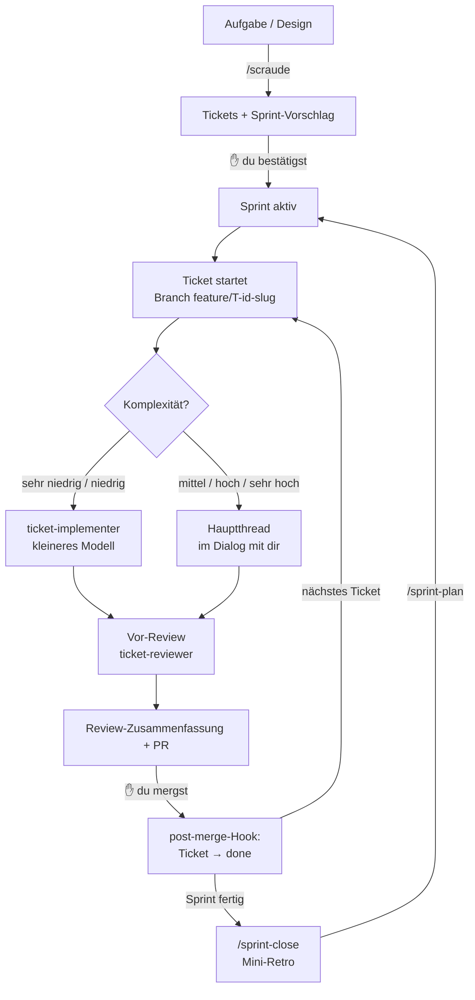

<div align="center">

# Scraude

**Scrum für die Arbeit mit Claude Code.**
Aufgaben rein, Tickets raus, ein PR pro Ticket — und kein Nebenthema geht mehr verloren.

[](https://code.claude.com/docs/en/plugins)
[](.claude-plugin/plugin.json)
[](LICENSE)


[Installation](#installation) · [Schnellstart](#schnellstart) · [So funktioniert's](#so-funktionierts) · [Befehle](#befehle) · [FAQ](#faq)

</div>

> **English summary:** Scraude is a Claude Code plugin that turns a task into
> a ticket board with sprints, one branch and one pull request per ticket.
> It captures side topics as backlog tickets, routes simple tickets to
> smaller models, and runs a second agent as a pre-review before you see the
> diff. You approve every PR and every merge. The plugin talks to you in
> German.

---

## Das Problem

Wer länger mit Claude Code arbeitet, kennt das:

- Mitten in einer Aufgabe fällt etwas Zweites auf — und dann ein Drittes.
  Entweder wird alles in einen Riesen-PR gepackt, oder es ist nach der
  Session vergessen.
- Jede neue Session beginnt bei null: Wo war ich? Was ist offen? Was
  blockiert?
- Ein Umbenennen in 40 Dateien läuft mit demselben großen Modell wie eine
  knifflige Race Condition.
- Der Diff landet ungefiltert beim Review, und der Review ist nur so gut wie
  die Zeit, die man gerade hat.

## Die Lösung

Scraude bringt einen schlanken Scrum-Ablauf direkt in Claude Code, ohne
externes Tool, ohne Account, ohne Server:

| | |
|---|---|
| 🧩 **Ein Einstieg** | `/scraude "<Aufgabe>"` zerlegt die Aufgabe in Tickets mit Abhängigkeiten und schlägt den ersten Sprint vor. Du bestätigst einmal. |
| 🔒 **Sprint-Lock** | Läuft ein Sprint, kommt nichts Neues mehr hinein. Alles Neue landet im Backlog, egal wie dringend es wirkt. |
| 🪝 **Nebenthemen auffangen** | Hat es mit dem laufenden Ticket nichts zu tun, wird es still als Backlog-Ticket notiert. Betrifft es das laufende Ticket, meldet Claude es sofort. |
| 🌿 **Ein Branch, ein PR pro Ticket** | `feature/T-<id>-<slug>`, PR über `gh` oder `glab`. Die Tickets sind von Anfang an so geschnitten, dass der Diff reviewbar bleibt. |
| 🧠 **Das passende Modell** | Jedes Ticket trägt eine Komplexität. Einfache Tickets übernimmt ein Subagent mit einem kleineren Modell, schwierige bleiben im Dialog mit dir. |
| 🔍 **Vor-Review durch einen zweiten Agenten** | Bevor du den Diff siehst, prüft ein eigener Agent ihn gegen die Ticket-Beschreibung. Mechanisch Eindeutiges behebt er in einem eigenen Commit, den Rest meldet er dir. |
| ☀️ **Standup bei Sessionbeginn** | Ein Hook legt den Board-Stand automatisch in den Kontext. Claude weiß sofort, wo es weitergeht. |
| ✅ **Du behältst die Kontrolle** | Claude merged nie selbst. PRs, Merges und das Schließen eines Sprints brauchen immer deine Freigabe. |

---

## Installation

Scraude wird als eigener Plugin-Marketplace direkt aus diesem Repo
installiert. In einer Claude-Code-Session:

```
/plugin marketplace add DerJojo11/scraude
/plugin install scraude@scraude-marketplace
```

Oder im Terminal:

```bash
claude plugin marketplace add DerJojo11/scraude
```

```bash
claude plugin install scraude@scraude-marketplace
```

### Voraussetzungen

- [Claude Code](https://code.claude.com)
- **Node.js** — die gebündelten Skripte laufen mit `node`, ohne
  npm-Abhängigkeiten
- **Git** — Scraude arbeitet mit Branches und einem `post-merge`-Hook
- *optional:* [`gh`](https://cli.github.com) oder
  [`glab`](https://gitlab.com/gitlab-org/cli), angemeldet, für echte
  Pull/Merge Requests. Fehlen beide, merged Scraude lokal, sobald du im
  Chat zustimmst.

---

## Schnellstart

**1. Board im Projekt anlegen**

```
/scraude:board-init
```

Legt `.claude/board.json` an, trägt sie in die `.gitignore` ein und
installiert den `post-merge`-Hook.

**2. Aufgabe hereingeben**

```
/scraude "Notizen-Feature: Datenmodell, REST-API und Editor im Frontend, offline-fähig"
```

Statt eines Pfads oder Links zu einem Design geht auch Freitext. Claude
zerlegt die Aufgabe, setzt Abhängigkeiten und Prioritäten und legt dir
Ticket-Schnitt **und** Sprint-Vorschlag in einer Liste vor.

**3. Bestätigen — der Rest läuft**

Nach deiner Bestätigung startet das erste Ticket auf einem eigenen Branch.
Ab jetzt ist Scraude ein **Modus**: Du arbeitest normal mit Claude, und der
Ablauf greift von selbst, auch in der nächsten Session.

**4. Board ansehen**

```
/scraude:board
```

```markdown
## BACKLOG (1)

| ID    | Titel                       | Typ     | Prio | Größe | A/K          | Alter  |
|-------|-----------------------------|---------|------|-------|--------------|--------|
| T-005 | Dark Mode für Einstellungen | feature | 4    | S     | sehr_niedrig | 0 Tage |

## SPRINT S-01 (active) — 0/4 fertig

| ID    | Titel                         | Status      | PR |
|-------|-------------------------------|-------------|----|
| T-001 | Datenmodell für Notizen       | sprint      | —  |
| T-002 | Spike: Sync-Strategie offline | in_progress | —  |
| T-003 | REST-Endpunkte für Notizen    | sprint      | —  |
| T-004 | Notiz-Editor im Frontend      | sprint      | —  |
```

---

## So funktioniert's



### Was automatisch läuft und was nicht

Ob etwas automatisch läuft, hängt nicht davon ab, wie wichtig es ist,
sondern davon, ob man es **rückgängig machen kann** und ob es **nach außen
sichtbar** ist.

| Läuft ohne Rückfrage | Braucht deine Bestätigung |
|---|---|
| Ticket starten, Branch anlegen | Ticket-Schnitt beim Intake |
| Nebenthemen als Tickets erfassen | PR / MR erstellen |
| Statuswechsel auf dem Board | Merge (macht Claude nie selbst) |
| Vor-Review samt Korrektur-Commit | Sprint schließen |
| Definition of Ready / Done prüfen | Scope aufteilen, Folge-Ticket abspalten |
| Nach dem Merge mit dem nächsten Ticket weitermachen | Sprint-Lock brechen |

### Modellwahl nach Komplexität

Jedes Ticket hat zwei getrennte Schätzungen: `groesse` (wie viel Diff,
also wie viel Review-Aufwand) und `komplexitaet` (wie schwer die Aufgabe
gedanklich ist). Ein Feld in 40 Dateien umzubenennen ist *groß, aber
trivial*. Eine Race Condition zu beheben ist *klein, aber heikel*.

| `komplexitaet` | Modell (Vorgabe) | Effort | Wer setzt um |
|---|---|---|---|
| `sehr_niedrig` | haiku | low | Subagent `ticket-implementer` |
| `niedrig` | sonnet | low | Subagent `ticket-implementer` |
| `mittel` | sonnet | medium | Hauptthread |
| `hoch` | opus | high | Hauptthread, Hinweis auf `/model` |
| `sehr_hoch` | opus | xhigh | Hauptthread, Hinweis auf `/model` |

Stellt sich ein Ticket als schwerer heraus als geschätzt, **bricht der
Implementer ab und meldet es**, statt sich durchzumogeln. Die Bewertung wird
im Ticket korrigiert, und die Arbeit geht im Hauptthread weiter.

Die Zuordnung steht im Board unter `modelle` und lässt sich pro Projekt
anpassen, ohne das Plugin anzufassen.

### Vor-Review ohne Freifahrtschein

Der `ticket-reviewer` hat den Implementierungsverlauf nicht gesehen, und
genau das ist gewollt. Er prüft, was ein generischer Code-Review nicht
prüfen kann:

- Deckt der Diff die Ticket-Beschreibung ab?
- Ist Scope hineingekrochen?
- Passt der Umfang zur geschätzten Größe?

Er gibt **bewusst kein Urteil** ab: kein „sieht gut aus“, keine Freigabe.
Sein Bericht soll deinen Review gezielter machen, nicht ersetzen.

### Mehrere Repos: frische Chats statt langer Verläufe

Hat ein Projekt mehrere Repos (App, Backend, Web), hält ein
**Koordinator-Chat** das Board und verteilt die Arbeit auf **je einen Chat
pro Repo**. Diese Chats laufen nicht über Sprints hinweg weiter — sie werden
pro Sprint neu gestartet, weil ein langer Verlauf in jeder neuen Runde
mitgelesen wird und irgendwann teurer ist als die Arbeit selbst.

Damit ein frischer Chat ohne den alten Verlauf auskommt, baut Scraude sein
Briefing aus dem Board: Repo, Base-Branch, die Tickets mit Beschreibung,
vereinbarte Schnittstellen, deine Projektregeln, das Meldeformat — und den
Befehl, mit dem der Chat den Board-Stand selbst liest.

- Das Modell folgt der Komplexität des schwersten Tickets im Bündel.
- Höchstens `config.maxParallelChats` Chats laufen gleichzeitig (Standard 2);
  blockierte Tickets warten, auch wenn ein Platz frei wäre.
- Bricht ein Chat ab, briefet der Nachfolger auf demselben Branch weiter —
  den Stand liest er aus `git status`, nicht aus dem verlorenen Verlauf.
  Uncommittete Arbeit wird nie verworfen.
- Gemergte Tickets führen zum Archivieren ihres Chats, nach deiner
  Bestätigung.

Durchgespielt an einem Beispiel mit zwei Repos:
[`examples/zwei-repos.md`](examples/zwei-repos.md).

---

## Befehle

Der Einstieg ist `/scraude`. Alle anderen Befehle lassen sich qualifiziert
(`/scraude:board`) oder kurz (`/board`) aufrufen. Die Kurzform geht, solange
kein anderes Plugin denselben Namen belegt.

| Befehl | Zweck |
|---|---|
| `/scraude "<Aufgabe>"` | Aufgabe zerlegen, Abhängigkeiten setzen, ersten Sprint vorschlagen |
| `/scraude:board-init` | Board anlegen, `.gitignore` ergänzen, `post-merge`-Hook installieren |
| `/scraude:board` | Board als Markdown-Tabelle anzeigen |
| `/scraude:standup` | Lagemeldung: was läuft, was pausiert, was blockiert, was als Nächstes kommt |
| `/scraude:ticket-new "<Titel>"` | Einzelnes Ticket im Backlog anlegen |
| `/scraude:sprint-plan` | Backlog aufräumen und den nächsten Sprint planen |
| `/scraude:ticket-start [T-<id>]` | Ticket starten; ohne ID das wichtigste nicht blockierte |
| `/scraude:ticket-resume` | Zuletzt pausiertes Ticket wieder aufnehmen |
| `/scraude:ticket-review [T-<id>]` | Vor-Review, Definition of Done, Zusammenfassung, PR |
| `/scraude:sprint-close` | Sprint abschließen, Mini-Retro |

Du musst diese Befehle nicht kennen. Sobald ein Board existiert, startet,
pausiert und erfasst Claude Tickets von selbst. Die Befehle sind
Einstiegspunkte und Ansichten.

---

## Prinzipien

- **Sprints sind Ticket-Sets, keine Zeiträume.** Ein Sprint ist fertig, wenn
  alle seine Tickets gemerged sind.
- **Priorität heißt Risiko und Wert, nicht Reihenfolge.** Die Reihenfolge
  ergibt sich aus `blockiert_von`. Ein Spike, an dem fünf Tickets hängen,
  gehört nach vorn, und `board-store.js impact` rechnet das aus.
- **Ein Ticket aktiv, Dringendes pausiert.** Ein Hotfix unterbricht nichts:
  Das laufende Ticket wird pausiert, Branch und Kontext bleiben erhalten.
- **Definition of Ready / Done** als feste Checklisten statt Bauchgefühl.
- **Mechanisches läuft über Skripte.** Status setzen, Board rendern,
  Blocker prüfen: Das erledigen deterministische Node-Skripte, keine
  Tokens. Claude wird nur dort eingesetzt, wo Urteilsvermögen gefragt ist.
- **Stichpunkte statt Fließtext**, überall dort, wo du etwas prüfen oder
  entscheiden sollst.

Die vollständige Begründung jeder Entscheidung steht in
[`scrum-board-plugin-plan.md`](scrum-board-plugin-plan.md).

---

## Deine Daten

- Das Board ist eine einzige JSON-Datei: `.claude/board.json` in deinem
  Repo.
- Sie ist **bewusst nicht versioniert**. `/board-init` trägt sie in die
  `.gitignore` ein, damit sie nicht in jedem PR und jedem Merge auftaucht.
- Scraude spricht mit keinem Dienst. PRs laufen über deine vorhandene
  `gh`- bzw. `glab`-Anmeldung.
- Mit der Umgebungsvariable `SCRAUDE_BOARD` lässt sich der Pfad
  überschreiben, etwa für ein Board außerhalb des Repos.

---

## FAQ

**Muss ich Scrum kennen?**
Nein. Scraude übernimmt nur das, was bei der Arbeit mit Claude hilft:
Tickets, Sprints als feste Pakete, Standup, Retro. Meetings, Story Points
und Rollen gibt es nicht.

**Funktioniert es mit GitLab?**
Ja, über `glab mr create`. Ohne `gh` und ohne `glab` merged Scraude lokal,
sobald du im Chat zustimmst.

**Was passiert in Repos ohne Board?**
Nichts. Die Hooks bleiben stumm, solange kein `.claude/board.json` existiert.

**Kann ich Scraude im Team nutzen?**
Version 1 ist für Einzelentwickler gedacht, das Board ist lokaler
Arbeitsstand. Über `SCRAUDE_BOARD` lässt sich ein gemeinsamer Pfad setzen;
eine Merge-Strategie für gleichzeitige Änderungen gibt es aber noch nicht.

**Warum ist alles auf Deutsch?**
Scraude ist auf Deutsch entstanden, und Befehle, Ausgaben und Feldnamen sind
deutsch. Eine englische Version ist denkbar. Wenn du sie brauchst, schreib
ein Issue.

---

## Bekannte Einschränkungen

- **Nach einem Plugin-Update** zeigt der `post-merge`-Hook noch auf den alten
  Plugin-Pfad. `/scraude:board-init` einmal erneut ausführen, dann stimmt es
  wieder. Der Hook meldet das selbst.
- Der Hook erkennt Tickets am Branch-Namen `feature/T-<id>-…` im
  Merge-Commit. Bei **Squash- oder Rebase-Merges** ohne diesen Namen in der
  Commit-Nachricht wird das Ticket nicht automatisch auf `done` gesetzt.

---

## Mitmachen

Issues und Pull Requests sind willkommen. Wie das Plugin aufgebaut ist und
wie man es lokal testet, steht in [`docs/ENTWICKLUNG.md`](docs/ENTWICKLUNG.md).

## Lizenz

[MIT](LICENSE) © Johannes Alecke
